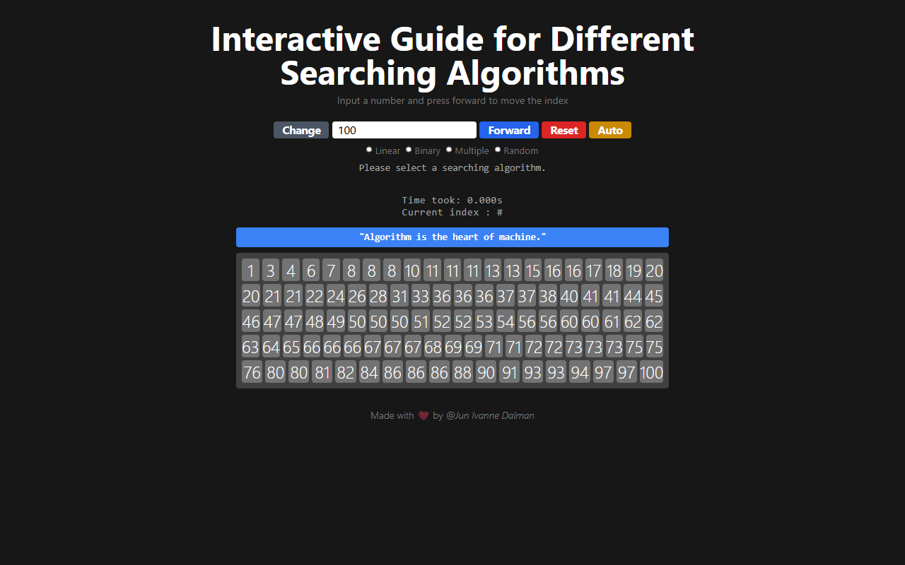

# Search Algorithm Visualiser

An interactive guide to four search algorithms. Pick one and watch it step through a sorted array to find a number. Made for a class presentation.

**[Try it live](https://interactive-search-algorithm.vercel.app)**

## Algorithms

- **Linear search:** checks each element in turn.
- **Binary search:** halves the search range at every step. Needs sorted data.
- **Jump search:** jumps ahead several elements at a time, then searches back one by one. Needs sorted data.
- **Random search:** checks random positions until it finds the number.

## Features

- Step forward one move at a time, or let it run on its own with **Auto**.
- Shows the time taken and the current index.
- Change the array size, or reset and try again.

## Run locally

Open `index.html` in a browser. There's no build step.

## Built with

JavaScript, HTML and CSS.
